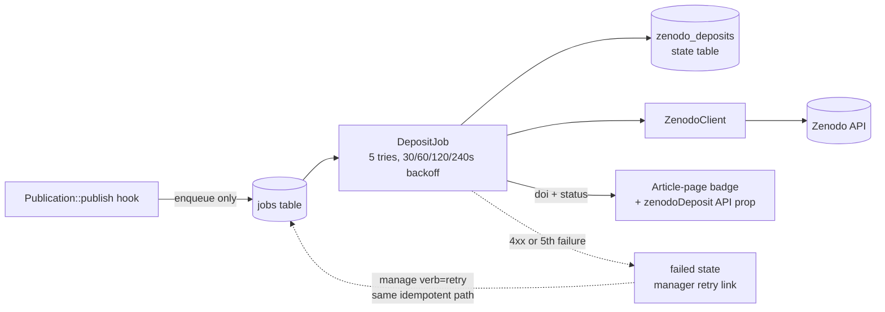
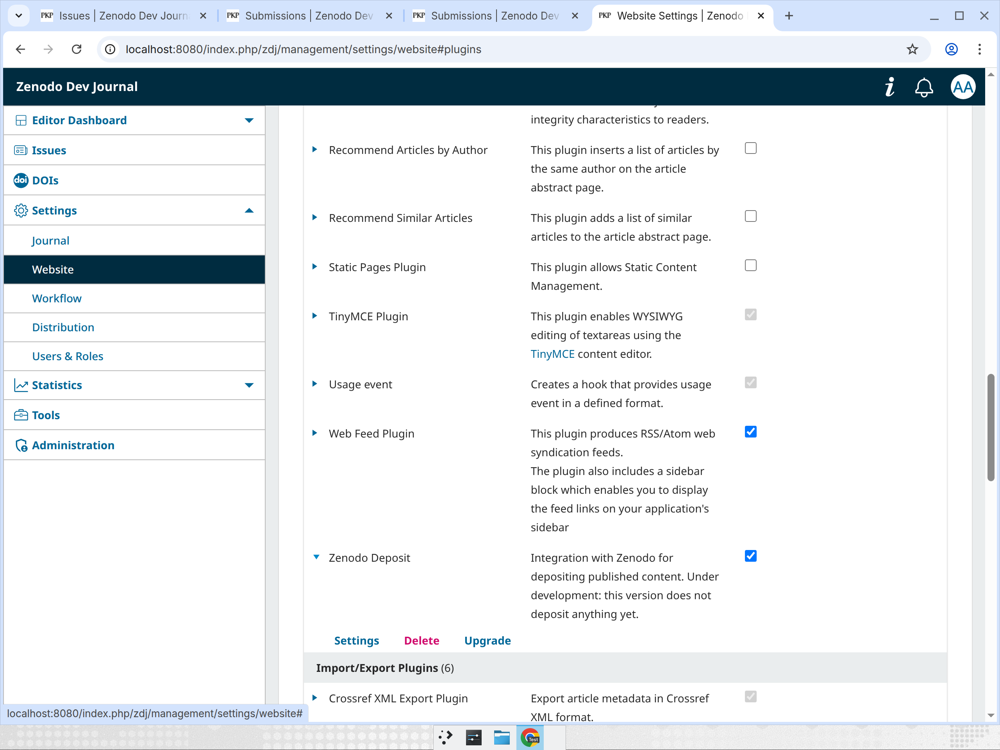
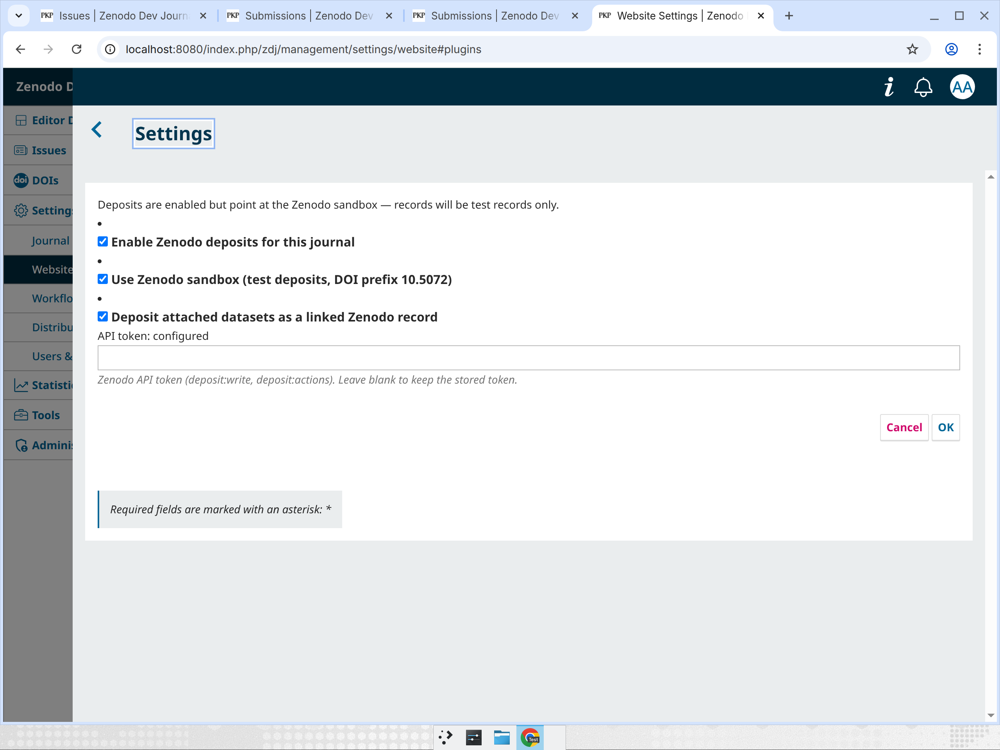
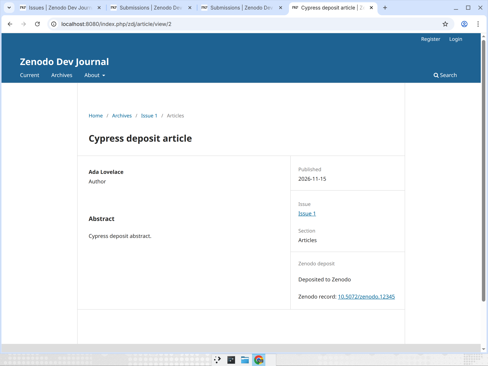
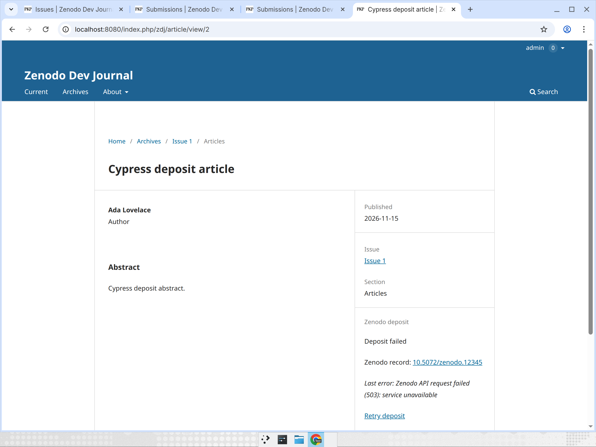
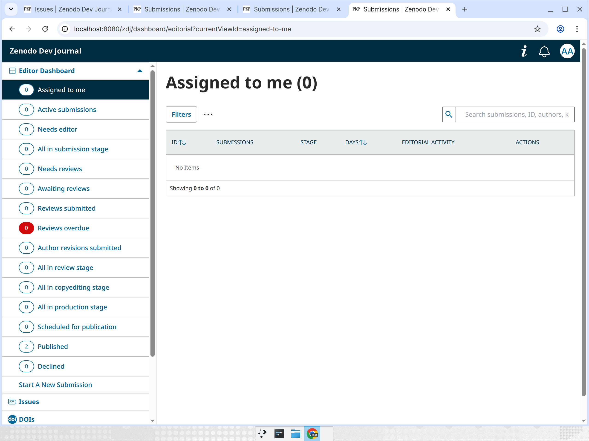

# OJS Zenodo Deposit

An OJS generic plugin that deposits published articles (and attached datasets)
to Zenodo, links the Zenodo DOI back to the article, and survives Zenodo
outages without blocking publication.

[](https://github.com/IV-cmd/ojs-zenodo-deposit/actions/workflows/ci.yml)

## Architecture



The hook only queues work; the worker owns retries. The deposition ID is
written to `zenodo_deposits` immediately after `createDeposition()`, so a
crash or retry resumes instead of creating a duplicate — see
[the deposit-flow notes](docs/deposit-flow.md). Field rules live in
[the mapping notes](docs/mapping.md).

## OJS compatibility

The development environment uses the official
[`pkpofficial/ojs:3_5_0-6`](https://hub.docker.com/r/pkpofficial/ojs) image,
pinned to digest
`sha256:0c26ece9e6af0c34961edfd2a187c5dc175ef5432b3d16d7c072de5d62d2c3f9`.
It contains OJS 3.5.0.6 and PHP 8.3.

The eventual target is OJS 3.6. At the time of writing, OJS 3.6.0.0 has no
release (no git tag, tarball, or official image), though `pkp/ojs` main reports
version 3.6.0.0. The plugin is developed and tested against OJS 3.5.0.6 and
will be re-checked on OJS 3.6 once it is released.

## Development environment

Copy `.env.example` to `.env` to customize the local database passwords. The
example values are development-only defaults and must not be used for a
deployed environment.

```sh
cp .env.example .env
make up
```

The first run opens the OJS web installer at
[http://localhost:8080](http://localhost:8080). Select MySQLi as the database
driver and use `db` as the database host, database name `ojs`, user `ojs`, and
the password from `.env` (or the development default). The configured files
directory is `/var/www/files`. Complete the installer to create an
administrator. Then create a journal via **Administration → Hosted Journals**
and enable **Zenodo Deposit** via **Settings → Website → Plugins → Generic**.

The OJS configuration persists in a named volume across `make down`. Use
`docker compose down -v` to reset the configuration, files, public files, and
database volumes.

To register the plugin's version metadata after installing OJS:

```sh
make install-plugin
```

This runs `php lib/pkp/tools/installPluginVersion.php
plugins/generic/zenodoDeposit/version.xml` from the OJS root. The repository is
mounted at `plugins/generic/zenodoDeposit` in the OJS container.

Use `make logs`, `make ojs-cli`, and `make down` to inspect and manage the
development stack.

## Zenodo client

The standalone client supports three modes:

- **Mock** (default) is deterministic, makes no network requests, and needs no
  Zenodo account.
- **Sandbox** uses `https://sandbox.zenodo.org`, separate sandbox credentials,
  and test DOIs with the `10.5072` prefix. Sandbox data can be wiped.
- **Live** can create real Zenodo records and DOIs. Set `zenodo_base_url`
  explicitly to `https://zenodo.org` when using live mode.

Development-only keys (`zenodo_mode`, `zenodo_mock_scenario`,
`zenodo_mock_step_delay`) remain code-level; the journal-facing settings live
in the settings form described below.

| Key | Default |
| --- | --- |
| `zenodo_mode` | `mock` |
| `zenodo_base_url` | `https://sandbox.zenodo.org` |
| `zenodo_token` | Empty |
| `zenodo_mock_scenario` | `success` |
| `zenodo_mock_step_delay` | `0` seconds |

To create a sandbox token, [register at Zenodo Sandbox](https://sandbox.zenodo.org)
and use [Applications → personal access tokens](https://sandbox.zenodo.org/account/settings/applications/tokens/new/)
with the `deposit:write` and `deposit:actions` scopes. The sandbox account and
token are separate from their production counterparts.

**Production `zenodo.org` is never the default, and sandbox mode refuses
`zenodo.org` and `www.zenodo.org`.**

The client fails fast with typed errors and never retries or sleeps; the
queued job owns backoff.

## Deposit flow

The development stack includes a separate queue worker and disables OJS's
built-in job runner so the publish request only enqueues the deposit. The
context settings include mock scenario and step-delay controls for offline
testing. See
[the deposit-flow guide](docs/deposit-flow.md) for the state machine, checkpoint
and recovery behavior, retry rules, and queue caveats.

## Configuration

Each journal configures deposits independently. A journal manager opens
**Settings → Website → Plugins → Generic → Zenodo Deposit → Settings** (the
`manage()` verb, so only managers and admins can reach it). The form offers:

- **Enable Zenodo deposits for this journal** — master switch, default off. A
  journal opts in deliberately; when off, the publish hook queues nothing.
- **Use Zenodo sandbox** — default on. Derives `zenodo_mode`/`zenodo_base_url`
  on save; an enabled+sandbox combination shows a warning that deposits will be
  test records only.
- **Deposit attached datasets** — default on; controls the linked
  `upload_type: dataset` deposition.
- **Zenodo API token** — write-only. The form shows "configured / not
  configured", never the value; blank keeps the stored token. Enabling deposits
  without a token fails validation.

Editors see each article's deposit status and Zenodo DOI link in a **Zenodo
deposit** block on the article page; managers additionally see the last error
and a **Retry deposit** link on failed deposits. Retry re-queues the M3 job
through the same idempotent path, so it cannot create a second deposition. The
same state rides the publication API as the `zenodoDeposit` property.

See [the configuration guide](docs/configuration.md) for the full field
reference and token-handling rules.

| | |
| --- | --- |
|  |  |
| Plugin enabled in the journal's plugin list | Per-journal settings form — the token shows "configured", never the value |
|  |  |
| Deposited badge on the article page | Failed deposit as a manager sees it — error plus retry link |
|  | |
| The editor dashboard — the OJS backend where published submissions are managed; deposits run in the background after publication | |

(Screenshots from the dev environment in mock mode; the `10.5072/...` DOI is
a test DOI.)

## Run modes

- **Dev environment** — `make up`, or the reproducible installer
  `./cypress/setup-env.sh` (also used by CI). Plugin in mock mode by default.
- **Mock mode** — deterministic, no network, no Zenodo account needed.
- **Sandbox mode** — real deposits to `sandbox.zenodo.org` with a personal
  access token (`deposit:write` scope); see
  [the configuration guide](docs/configuration.md).

## Deployment (Kubernetes)

`deploy/helm/ojs-zenodo/` is a chart that runs OJS (community
`pkpofficial/ojs` image — there is no official one), a MySQL pod, and a
queue-worker Deployment. The plugin is delivered by an init container that
copies a plugin image built from `deploy/plugin.Dockerfile` — building the
plugin into the OJS image instead is the documented alternative (roadmap).
Secrets (DB password, Zenodo token) come only from a Secret.

```sh
helm install ojs deploy/helm/ojs-zenodo --set secrets.mysqlPassword=...
```

## Tests and static checks

The offline unit tests run without an OJS checkout. Test-only stand-ins for the
PKP plugin and queue APIs and translation helper are loaded by the test
bootstrap. The tests cover plugin metadata and hook registration, the standalone
client, mapper, state store, deposit service, retry policy, and queue job
settings. OJS-specific persistence and worker behavior also require the local
container.

Run the checks locally with PHP 8.2 or newer and Composer:

```sh
composer install
make test
make lint
make analyse
```

GitHub Actions runs the same checks on PHP 8.2 and 8.3, plus a Cypress
end-to-end job that boots the Docker dev stack (`./cypress/setup-env.sh`),
seeds a journal, and runs the specs in `cypress/e2e/` against the real OJS
(publish → deposit → badge, outage → retry, settings secrecy). See
[docs/testing.md](docs/testing.md). `.gitlab-ci.yml` mirrors the same pipeline
for GitLab environments; GitHub Actions is the primary CI.

## Tested and limits

- Developed and tested on **OJS 3.5.0.6** (official `pkpofficial` image);
  targets OJS 3.6, which has no release yet — 3.6 compatibility is unverified.
- No real `sandbox.zenodo.org` round-trip — that needs a live token.
- Editors see deposit status on the article page; a workflow-SPA panel is not
  possible on OJS 3.5 (the hook was removed).
- DOI write-back is display-only; the article's own DOI is never overwritten.

## Roadmap

- Real sandbox validation with a live token.
- Bake the plugin into the OJS image instead of the init-container copy.
- Auto-seed plugin settings from the chart's env/secret at install time.

## Plugin compatibility metadata

OJS plugin `version.xml` does not define an OJS-compatibility field.
Compatibility information belongs in the plugin gallery's `plugins.xml`, not
in this plugin's version metadata.
